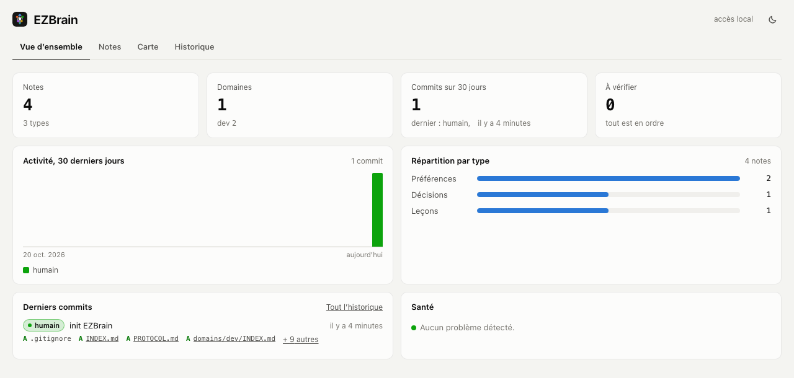
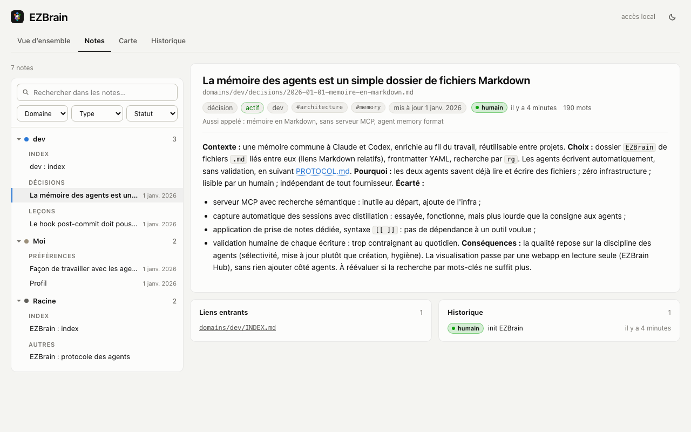
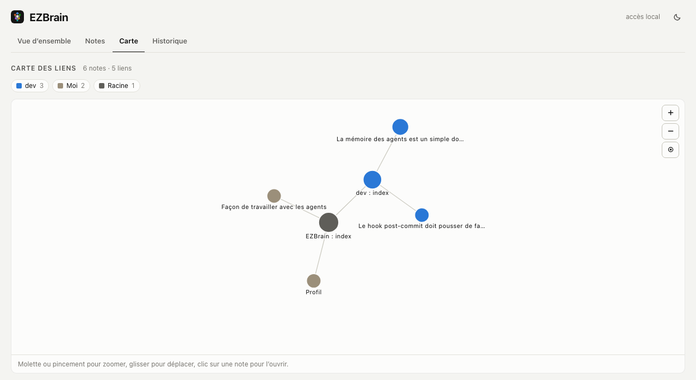

# EZBrain

**Mémoire long terme partagée entre agents IA, en simples fichiers Markdown dans un dépôt git local.**

Claude Code, Codex et les autres agents oublient tout d'une session à l'autre. EZBrain leur donne un dossier commun,
lu au début d'une tâche et mis à jour à la fin : décisions, préférences, leçons, état des projets.
Ni serveur, ni MCP, ni base vectorielle côté agents. Des fichiers, un protocole court et l'historique git.

[English version](README.md)



## Fonctionnement

1. La mémoire est un dossier de notes Markdown rangées par domaine (`domains/dev`, `domains/web`...), chacun avec un petit index.
2. Quelques lignes dans la consigne de l'agent (`CLAUDE.md`, `AGENTS.md`) lui demandent de lire l'index utile avant
   une tâche non triviale, puis 1 à 3 notes, rien de plus.
3. Avant sa réponse finale, l'agent fait le bilan de ce qu'il a appris et met la mémoire à jour si quelque chose mérite
   d'être conservé, puis commit en local avec son nom en préfixe (`claude: …`, `codex: …`).
4. En option, une webapp en lecture seule (le Hub) affiche les notes, le graphe des liens et l'auteur de chaque écriture.

Les règles suivies par les agents sont dans [`memory-template/PROTOCOL.md`](memory-template/PROTOCOL.md).

## Contenu

| Dossier | Rôle |
|---|---|
| `memory-template/` | Modèle de la mémoire : `PROTOCOL.md` (les règles des agents), `INDEX.md`, un domaine d'exemple, `me/` à remplir, l'outil `tools/ezbrain.py`, les hooks git |
| `agent-instructions.md` | La consigne à coller dans `~/.claude/CLAUDE.md` et `~/.codex/AGENTS.md` |
| `hub/` | EZBrain Hub : webapp de visualisation en lecture seule (Hono, React), déployée sur un serveur privé derrière Tailscale |

Ce dépôt contient la méthode et le code, sans aucune donnée réelle : les notes fournies sont des exemples fictifs.

## Démarrer (mémoire seule, 5 minutes)

Prérequis : `git` et `python3`. [`ripgrep`](https://github.com/BurntSushi/ripgrep) est conseillé, les agents s'en servent pour chercher.

```bash
git clone https://github.com/Axxxxpirine/EZBrain.git ezbrain-kit
cp -R ezbrain-kit/memory-template ~/EZBrain
cd ~/EZBrain
git init -b main
cp hooks/pre-push .git/hooks/ && chmod +x .git/hooks/pre-push   # refuse tout push vers GitHub, GitLab, Bitbucket
git add -A && git commit -m "init EZBrain"
python3 tools/ezbrain.py check                                   # liens et frontmatter
```

Ensuite :

1. Coller la consigne de [`agent-instructions.md`](agent-instructions.md) dans les agents (adapter le chemin si besoin).
2. Remplir `me/profile.md` et `me/working-style.md`.
3. Renommer ou compléter le domaine d'exemple `domains/dev`.

Les agents créent et entretiennent ensuite les notes au fil du travail.

## Garder sa mémoire privée

La mémoire finit par contenir des informations personnelles et professionnelles :

- La créer **en dehors** du clone de ce dépôt (le démarrage rapide copie le modèle dans `~/EZBrain`) : elle a ainsi
  son propre historique git et ne peut pas être poussée ici par erreur.
- Installer le hook `pre-push`. Les hooks git ne sont pas versionnés : le réinstaller après avoir cloné la mémoire sur une autre machine.
- Ne jamais ouvrir d'issue ou de pull request contenant de vraies notes.

## Le Hub (facultatif)

Une webapp en lecture seule pour consulter la mémoire depuis tous ses appareils : vue d'ensemble et santé, notes
rendues avec liens entrants, graphe des liens, recherche, historique des commits par agent.

| Note avec liens entrants et historique | Carte des liens |
|---|---|
|  |  |

Il faut une machine allumée en permanence, Node 22.13 ou plus récent et [Tailscale](https://tailscale.com). Chaque
commit de la mémoire est poussé vers cette machine par un hook `post-commit`. Le script de déploiement vise macOS
(LaunchAgent) ; le serveur lui-même tourne partout où Node tourne. Voir [`hub/README.md`](hub/README.md) et lire
[`SECURITY.md`](SECURITY.md) avant de l'exposer.

## Principes de conception

- **Sobriété** : lire peu (index → domaine → 1 à 3 notes), écrire peu (0 à 2 écritures par session). La mémoire doit faire gagner du temps, pas en coûter.
- **Zéro infrastructure côté agents** : pas de serveur MCP ni de capture de sessions ; les agents savent déjà lire et écrire des fichiers.
- **Retrouvabilité** : un domaine par sphère, un index par domaine avec une section Essentiel, une note de référence par information.
- **Traçabilité** : un commit local par écriture, préfixé par l'agent, visible dans l'historique de la webapp.
- **Confidentialité** : la mémoire ne quitte pas le poste et le serveur privé (hook `pre-push`).

## Contribuer

Issues et pull requests bienvenues, en français ou en anglais. Avant d'ouvrir une pull request :

```bash
cd hub && npm ci && npm test && npm run typecheck && npm run build
python3 memory-template/tools/ezbrain.py check
```

## Licence

[MIT](LICENSE)
