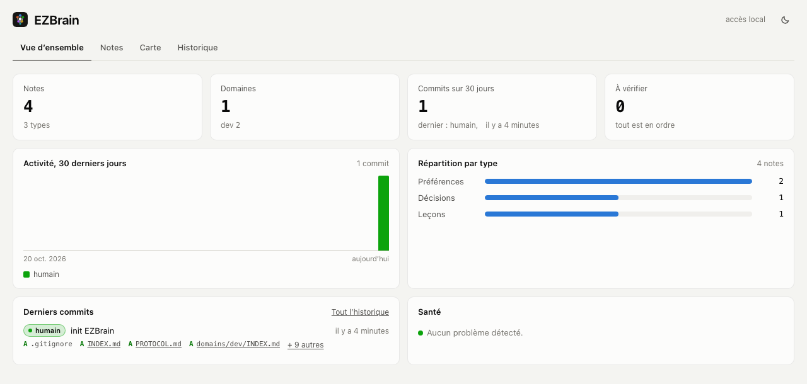
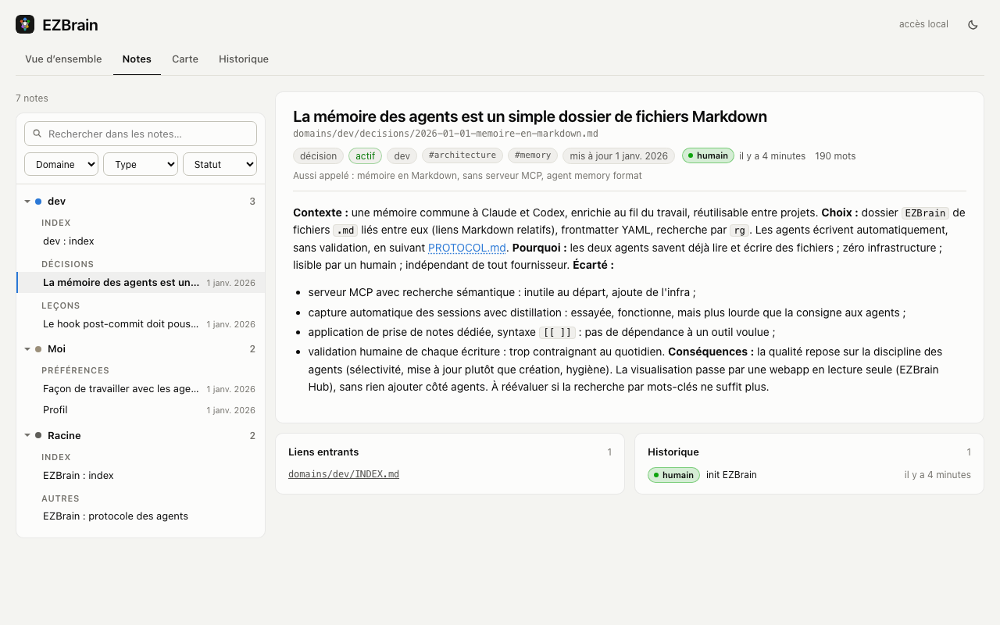
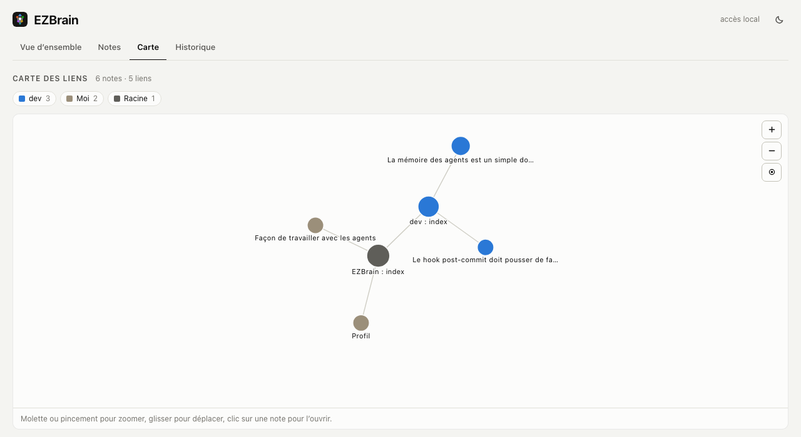

# EZBrain

**Shared long-term memory for AI coding agents, as plain Markdown files in a local git repository.**

Claude Code, Codex and other agents forget everything between sessions. EZBrain gives them one folder they all
read at the start of a task and update at the end: decisions, preferences, lessons learned, project status.
No server, no MCP, no vector database on the agent side. Just files, a short protocol, and git history.

[Version française](README.fr.md)



## How it works

1. Your memory is a folder of Markdown notes, sorted by domain (`domains/dev`, `domains/web`, ...), each with a small index.
2. A few lines in the agent's instructions (`CLAUDE.md`, `AGENTS.md`) tell it to read the relevant index before a
   non-trivial task, then 1 to 3 notes, nothing more.
3. Before its final answer, the agent reviews what it learned and updates the memory if something is worth keeping,
   then commits locally with its name as prefix (`claude: ...`, `codex: ...`).
4. Optionally, a read-only web app (the Hub) shows the notes, the link graph and who wrote what.

The rules the agents follow are in [`memory-template/PROTOCOL.md`](memory-template/PROTOCOL.md).

## What is in this repository

| Path | Role |
|---|---|
| `memory-template/` | Starting point for your memory: `PROTOCOL.md` (rules for agents), `INDEX.md`, one example domain, `me/` to fill in, the `tools/ezbrain.py` checker, git hooks |
| `agent-instructions.md` | The snippet to paste into `~/.claude/CLAUDE.md` and `~/.codex/AGENTS.md` |
| `hub/` | EZBrain Hub: optional read-only web app (Hono, React), meant to run on a private server behind Tailscale |

This repository contains the method and the code only. All notes in it are fictional examples.

> **Language.** The protocol, the agent instructions, the example notes and the Hub interface are written in French.
> Agents follow the protocol regardless of the language you talk to them in. If you prefer another language,
> ask your agent to translate `PROTOCOL.md` and `agent-instructions.md` once: they are short.

## Quick start (memory only, 5 minutes)

Requirements: `git` and `python3`. [`ripgrep`](https://github.com/BurntSushi/ripgrep) is recommended, agents use it to search.

```bash
git clone https://github.com/Axxxxpirine/EZBrain.git ezbrain-kit
cp -R ezbrain-kit/memory-template ~/EZBrain
cd ~/EZBrain
git init -b main
cp hooks/pre-push .git/hooks/ && chmod +x .git/hooks/pre-push   # refuses any push to GitHub, GitLab, Bitbucket
git add -A && git commit -m "init EZBrain"
python3 tools/ezbrain.py check                                   # checks links and frontmatter
```

Then:

1. Paste the snippet from [`agent-instructions.md`](agent-instructions.md) into your agents' instructions (adjust the path if needed).
2. Fill in `me/profile.md` and `me/working-style.md`.
3. Rename or extend the example domain `domains/dev`.

From there the agents create and maintain the notes as you work.

## Keep your memory private

Your memory will end up holding personal and professional information. Treat it accordingly:

- Create it **outside** your clone of this repository (the quick start copies the template to `~/EZBrain`), so it has
  its own git history and can never be pushed here by mistake.
- Install the `pre-push` hook. Git hooks are not versioned: reinstall it after cloning your memory to a new machine.
- Never open an issue or a pull request containing real notes.

## The Hub (optional)

A read-only web app to browse the memory from any of your devices: overview and health checks, rendered notes with
backlinks, link graph, search, commit history per agent.

| Note with backlinks and history | Link graph |
|---|---|
|  |  |

It needs a machine that is always on, Node 22.13 or later, and [Tailscale](https://tailscale.com). Each commit of your
memory is pushed to that machine by a `post-commit` hook. The deployment script targets macOS (LaunchAgent); the
server itself runs anywhere Node does. See [`hub/README.md`](hub/README.md) and read [`SECURITY.md`](SECURITY.md)
before exposing it.

## Design principles

- **Frugal.** Read little (index, domain, 1 to 3 notes), write little (0 to 2 writes per session). The memory must save time, not cost it.
- **No infrastructure on the agent side.** Agents already know how to read and write files.
- **Findable.** One domain per sphere of activity, one index per domain with an "Essentiel" section, one reference note per piece of information.
- **Traceable.** One local commit per write, prefixed with the agent's name.
- **Private.** The memory stays on your machine and your private server.

## Contributing

Issues and pull requests are welcome, in English or French. Before opening a pull request:

```bash
cd hub && npm ci && npm test && npm run typecheck && npm run build
python3 memory-template/tools/ezbrain.py check
```

## License

[MIT](LICENSE)
